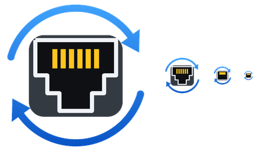
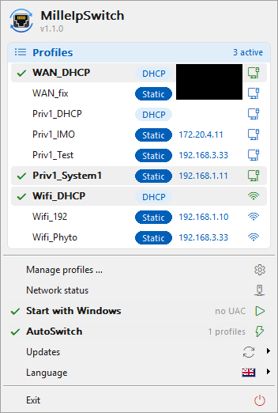
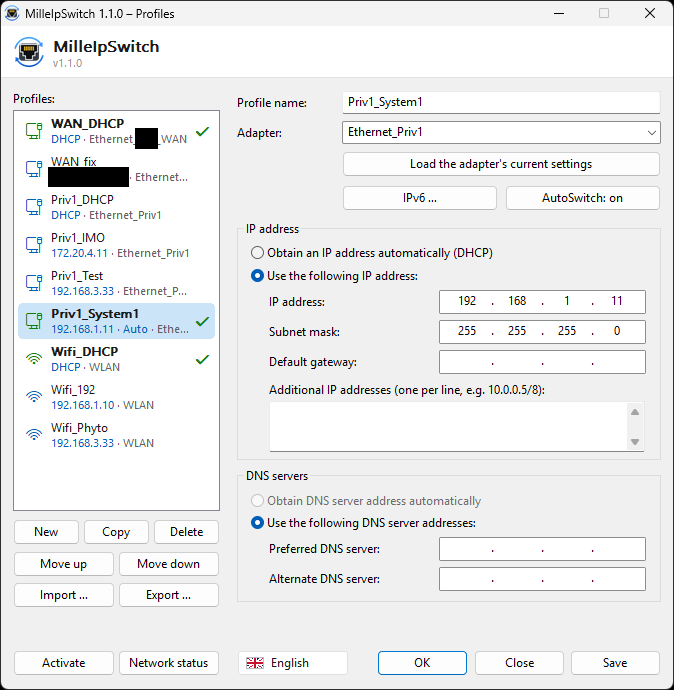
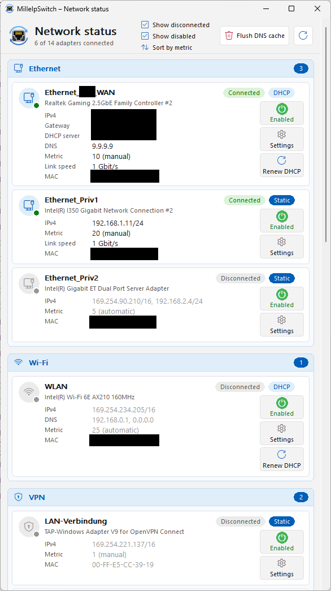
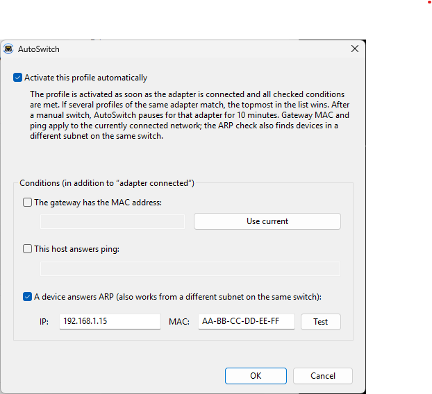

<p align="center">
  
</p>

<h1 align="center">MilleIpSwitch</h1>

<p align="center">
  Schneller, schlanker Netzwerkprofil-Umschalter für Windows – eine kleine Alternative zu NetSetMan.<br>
  <a href="README.md">English</a> · <b>Deutsch</b>
</p>

| Tray-Menü | Profilverwaltung | Netzwerkstatus |
|---|---|---|
|  |  |  |

## Funktionen

- **Profile in Millisekunden umschalten** – feste IPv4 (auch mehrere pro Adapter), Subnetzmaske, Gateway, DNS oder DHCP
- **IPv6** pro Profil: automatisch oder feste Adressen, Gateway und DNS
- **AutoSwitch**: Profile aktivieren sich selbst, wenn ein Adapter verbunden ist, die Gateway-MAC passt oder ein Host auf Ping antwortet
- **Tray-Menü** mit Markierung der aktiven Profile; pro Adapter kann gleichzeitig ein Profil aktiv sein
- **Kurzübersicht** beim Überfahren des Tray-Symbols: verbundene Adapter, IPs, Geschwindigkeit und aktive Profile
- **Profilverwaltung** im Stil des Windows-IPv4-Dialogs, inklusive „aktuelle Einstellungen des Adapters übernehmen“
- **Netzwerkstatus** aller Adapter, gruppiert nach Ethernet, WLAN, VPN, virtuell und Sonstige – mit DHCP-Server und MAC, Ein/Aus-Schalter pro Adapter und Sprung in die Adaptereigenschaften
- **Import / Export** der Profile und automatische Sicherungen der Profildatei
- **Update-Hinweis** über GitHub-Releases (täglich, abschaltbar)
- **Kommandozeile** für Skripte, Hotkeys und das Stream Deck: `milleipswitch.exe "Labor"`
- **Autostart ohne UAC-Abfrage** (Aufgabenplanung) – danach brauchen auch Kommandozeilenaufrufe keine Adminabfrage
- Deutsch, Englisch, Spanisch und Französisch
- Eine einzelne portable `.exe` (~500 KB), kein Installer, keine Laufzeitumgebung, kein Dienst

## Warum es schnell ist

MilleIpSwitch setzt Adressen, Gateway und DNS direkt über die IP-Helper-API statt über `netsh`/WMI und ändert nur, was sich vom Ist-Zustand unterscheidet. Nur der Wechsel zwischen DHCP und statisch läuft über einen einzigen `netsh`-Aufruf. Die benötigte Zeit steht in der Benachrichtigung.

## Download

**winget** (sobald das Paket im winget-Repository veröffentlicht ist):

```
winget install 666mille.MilleIpSwitch
```

**Scoop:**

```
scoop install https://github.com/666mille/MilleIpSwitch/releases/latest/download/milleipswitch.json
```

**Manuell:**

`milleipswitch.exe` aus dem [neuesten Release](../../releases/latest) in einen beliebigen Ordner legen, z. B. `C:\Tools\MilleIpSwitch\`. Die Profile liegen in `%APPDATA%\MilleIpSwitch\profiles.ini`. Für einen portablen Betrieb legst du `profiles.ini` (oder eine leere Datei namens `portable`) neben die EXE.

> Die EXE ist nicht signiert; Windows SmartScreen kann beim ersten Start warnen („Weitere Informationen“ → „Trotzdem ausführen“).
> Da MilleIpSwitch Netzwerkeinstellungen ändert und eine Autostart-Aufgabe mit Adminrechten anlegen kann, melden manche
> Virenscanner es heuristisch. Der komplette Quellcode liegt in diesem Repository; du kannst es auch selbst bauen.

## AutoSwitch



Öffne in der Profilverwaltung bei einem Profil **AutoSwitch …** und hake *Dieses Profil automatisch aktivieren* an. Das Profil wird aktiviert, sobald sein Adapter verbunden ist und alle angehakten Bedingungen zutreffen:

- das Gateway hat eine bestimmte **MAC-Adresse** (*Aktuelle übernehmen* liest sie aus dem verbundenen Netz)
- ein bestimmter **Host antwortet auf Ping** (IP-Adresse oder Name)
- ein **Gerät antwortet auf ARP** (IP-Adresse, optional mit MAC) – das findet auch Geräte in einem anderen Subnetz am selben Switch, denn es wird nur ein ARP-Paket gesendet und am Adapter nichts verändert

MilleIpSwitch prüft alle 5 Sekunden. Umgeschaltet wird erst, wenn zwei Prüfungen hintereinander übereinstimmen, höchstens einmal in 30 Sekunden pro Adapter. Passen mehrere Profile eines Adapters, gewinnt das oberste in der Liste. Wenn du manuell umschaltest, pausiert AutoSwitch für diesen Adapter 10 Minuten (im Tray-Menü zu sehen). Das Kabel neu zu stecken (mindestens 5 Sekunden getrennt) oder AutoSwitch aus- und wieder einzuschalten beendet die Pause. Im Tray-Menü lässt sich AutoSwitch ganz abschalten.

Gateway-MAC und Ping werden aus dem aktuell verbundenen Netz geprüft; ein Gerät in einem anderen Subnetz ist von dort per Ping nicht erreichbar. Dafür gibt es die ARP-Bedingung.

Beispiel: *Büro statisch* (Regel: Gateway-MAC des Büro-Routers) steht über *Standard DHCP* (keine weiteren Bedingungen). Im Büro übernimmt das statische Profil, sobald DHCP dich verbunden hat; überall sonst gilt das DHCP-Profil.

## IPv6

Mit **IPv6 …** in der Profilverwaltung lässt ein Profil IPv6 unverändert (Standard), bezieht es automatisch oder verwendet feste Adressen mit Gateway und DNS. Bei festem IPv6 werden Router-Advertisements für den Adapter abgeschaltet. Windows behält so gesetzte feste IPv6-Adressen nicht über einen Neustart, deshalb wendet MilleIpSwitch beim nächsten Start das zuletzt aktive Profil eines Adapters erneut an, falls es festes IPv6 nutzt.

## Update-Prüfung und Datenschutz

Einmal täglich fragt MilleIpSwitch bei `api.github.com` nach dem neuesten Release dieses Repositories (HTTPS, es werden keine persönlichen Daten gesendet) und zeigt einen Hinweis, falls es eine neuere Version gibt. Es lädt oder installiert nie etwas selbstständig. Die Prüfung lässt sich im Tray-Menü unter *Updates* abschalten.

## Sicherungen, Import und Export

Bei jedem Speichern wird die vorherige `profiles.ini` in einen Ordner `backups` neben der Datei kopiert (die letzten 10 bleiben erhalten). Mit *Exportieren …* und *Importieren …* in der Profilverwaltung tauschst du Profile als `.ini`-Dateien aus; importierte Profile werden deiner Liste hinzugefügt.

## Bedienung

| Aufruf | Wirkung |
|---|---|
| `milleipswitch.exe` | Startet MilleIpSwitch: Tray-Symbol und Profilverwaltung |
| `milleipswitch.exe --tray` | Nur Tray-Symbol (für den Autostart) |
| `milleipswitch.exe "<Profil>"` | Profil anwenden |
| `milleipswitch.exe --list` | Profile auflisten (`*` = aktiv) |
| `milleipswitch.exe --status` | Alle Adapter anzeigen |
| `milleipswitch.exe --edit` | Profilverwaltung öffnen |
| `milleipswitch.exe --version` | Version anzeigen |

Mit **Mit Windows starten** im Tray-Menü startet MilleIpSwitch bei der Anmeldung mit Adminrechten, aber ohne UAC-Abfrage.

## Selbst bauen

Siehe [README.md → Building](README.md#building). Kurz: Ordner in Visual Studio oder VS Code (CMake-Erweiterung) öffnen und bauen, oder `build.bat` in der *x64 Native Tools Command Prompt* ausführen.

## Lizenz

[MIT](LICENSE)
