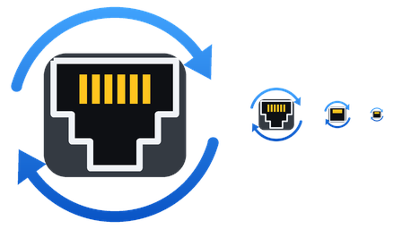
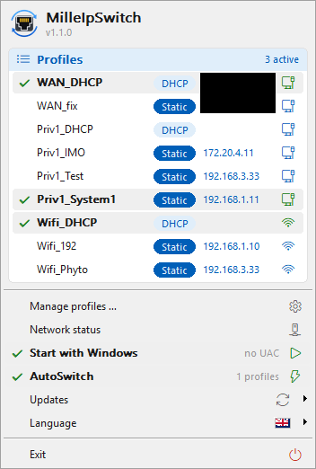
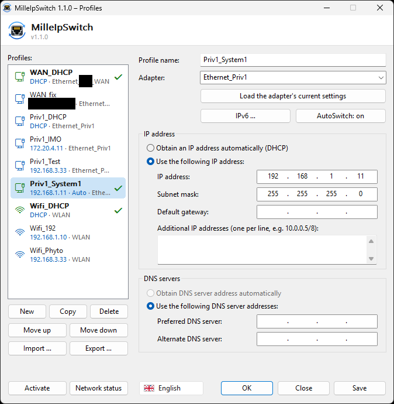
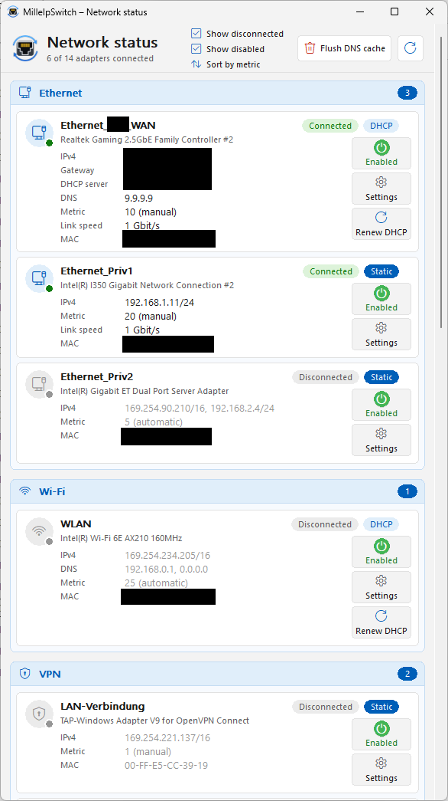
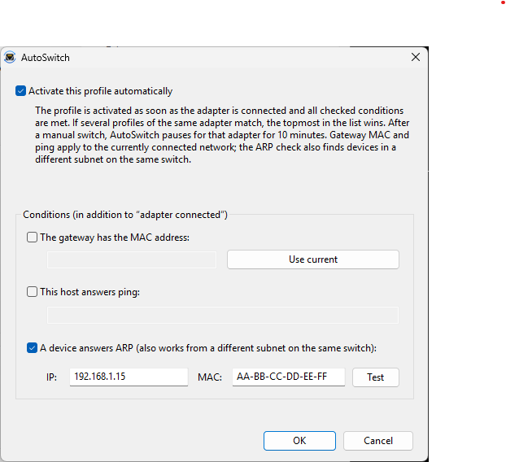

<p align="center">
  
</p>

<h1 align="center">MilleIpSwitch</h1>

<p align="center">
  Fast, lightweight network profile switcher for Windows – a small alternative to NetSetMan.<br>
  <b>English</b> · <a href="README.de.md">Deutsch</a>
</p>

<p align="center">
  <a href="../../actions/workflows/build.yml"></a>
  <a href="../../releases/latest"></a>
  
  <a href="LICENSE"></a>
</p>

| Tray menu | Profile manager | Network status |
|---|---|---|
|  |  |  |

## Features

- **Switch profiles in milliseconds** – static IPv4 (also multiple addresses per adapter), subnet mask, gateway, DNS or DHCP
- **IPv6** per profile: automatic or static addresses, gateway and DNS
- **AutoSwitch**: profiles activate themselves when an adapter connects, the gateway MAC matches or a host answers ping
- **Tray menu** with the active profile(s) marked, one profile per adapter can be active at the same time
- **Hover card** on the tray icon with all connected adapters, IPs, link speed and active profiles
- **Profile manager** in the style of the Windows IPv4 dialog, including “load the adapter's current settings”
- **Network status** for all adapters, grouped into Ethernet, Wi-Fi, VPN, virtual and other – incl. DHCP server and MAC, an on/off switch per adapter and a shortcut to its properties
- **Import / export** of profiles and automatic backups of your profile file
- **Update notification** via GitHub releases (daily, can be switched off)
- **Command line** for scripts, hotkeys and the Stream Deck: `milleipswitch.exe "Lab"`
- **Autostart without UAC prompt** (Task Scheduler) – afterwards command line calls need no elevation either
- English, German, Spanish and French
- A single portable `.exe` (~500 KB), no installer, no runtime, no service

## Why it is fast

Most tools call `netsh` or WMI for every single setting. MilleIpSwitch talks to the Windows IP Helper API directly:

| Task | API |
|---|---|
| IP addresses | `CreateUnicastIpAddressEntry` / `DeleteUnicastIpAddressEntry` (no duplicate address detection delay) |
| Default gateway | `CreateIpForwardEntry2` / `DeleteIpForwardEntry2` |
| DNS | `SetInterfaceDnsSettings` (no DNS validation, Windows 10 2004+) |

Only settings that differ from the current state are changed. The single exception is switching between DHCP and static, which uses one `netsh` call because Windows has no documented API for it. The time each switch took is shown in the notification.

## Download

**winget** (once the package is published in the winget repository):

```
winget install 666mille.MilleIpSwitch
```

**Scoop:**

```
scoop install https://github.com/666mille/MilleIpSwitch/releases/latest/download/milleipswitch.json
```

**Manual:**

Get `milleipswitch.exe` from the [latest release](../../releases/latest) and put it into any folder, e.g. `C:\Tools\MilleIpSwitch\`. Profiles are stored in `%APPDATA%\MilleIpSwitch\profiles.ini`. For a portable setup put `profiles.ini` (or an empty file named `portable`) next to the exe.

> The exe is not code-signed, so Windows SmartScreen may warn on first start (“More info” → “Run anyway”).
> Because MilleIpSwitch changes network settings and can register an elevated autostart task, some antivirus
> products may flag it heuristically. The full source is in this repository – you can also build it yourself, see below.

## Usage

| Command | Effect |
|---|---|
| `milleipswitch.exe` | Starts MilleIpSwitch: tray icon and profile manager |
| `milleipswitch.exe --tray` | Tray icon only (used for autostart) |
| `milleipswitch.exe "<profile>"` | Applies a profile |
| `milleipswitch.exe --list` | Lists profiles (`*` = active) |
| `milleipswitch.exe --status` | Shows all adapters |
| `milleipswitch.exe --edit` | Opens the profile manager |
| `milleipswitch.exe --version` | Shows the version |

Exit codes: `0` OK, `1` error, `2` unknown profile, `3` error in profiles.ini, `4` switch already in progress.

Changing IP settings requires administrator rights. If the tray instance is running (elevated), command line calls are handed over to it, so no UAC prompt appears. Enable **Start with Windows** in the tray menu to get this from sign-in on.

## AutoSwitch



In the profile manager open **AutoSwitch …** for a profile and tick *Activate this profile automatically*. The profile is activated as soon as its adapter is connected and all checked conditions are met:

- the gateway has a given **MAC address** (*Use current* reads it from the connected network)
- a given **host answers ping** (IP address or name)
- a **device answers ARP** (IP address, optionally with its MAC) – this also finds devices in a different subnet on the same switch, because only one ARP packet is sent and nothing on your adapter is changed

MilleIpSwitch checks every 5 seconds. A change is only made after two consecutive checks agree, at most once per 30 seconds and adapter. If several profiles of one adapter match, the topmost in the list wins. After you switch a profile manually, AutoSwitch pauses for that adapter for 10 minutes (shown in the tray menu). Reconnecting the cable (unplugged for at least 5 seconds) or switching AutoSwitch off and on ends the pause. AutoSwitch can be switched off completely in the tray menu.

Gateway MAC and ping are checked from the currently connected network; a device in a different subnet is not reachable by ping from there. Use the ARP condition for that.

Example: *Office static* (rule: gateway MAC of the office router) above *Default DHCP* (no extra conditions). In the office the static profile takes over as soon as DHCP has connected you; elsewhere the DHCP profile applies.

## IPv6

**IPv6 …** in the profile manager lets a profile leave IPv6 untouched (default), obtain it automatically, or use static addresses with gateway and DNS. With static IPv6 router advertisements are turned off for the adapter. Windows does not keep static IPv6 addresses set this way across a restart, so MilleIpSwitch re-applies the last active profile of an adapter at its next start if that profile uses static IPv6.

## Update check and privacy

Once a day MilleIpSwitch asks `api.github.com` for the latest release of this repository (HTTPS, no personal data sent) and shows a notification if a newer version exists. It never downloads or installs anything on its own. You can switch the check off in the tray menu under *Updates*.

## Backups, import and export

Every time profiles are saved, the previous `profiles.ini` is copied to a `backups` folder next to it (the last 10 are kept). *Export …* and *Import …* in the profile manager exchange profiles as `.ini` files; imported profiles are added to your list.

## profiles.ini

Profiles can be edited in the GUI or by hand:

```ini
[Lab]
adapter = Ethernet
dhcp    = no
ip      = 192.168.10.50/24, 10.0.0.5/8
gateway = 192.168.10.1
dns     = 192.168.10.1, 1.1.1.1
ipv6    = static
ip6     = 2001:db8:10::50/64
gateway6 = 2001:db8:10::1
dns6    = 2001:4860:4860::8888
auto    = yes
auto_gateway_mac = AA-BB-CC-DD-EE-FF

[Office]
adapter = Ethernet
dhcp    = yes
```

See [`profiles.example.ini`](profiles.example.ini) for all options.

## Building

Requirements: Windows SDK and a C++17 compiler (Visual Studio 2019+ or MinGW-w64), CMake 3.20+.

**Visual Studio / VS Code:** open the folder (CMake is detected automatically) and build the `milleipswitch` target, or run `build.bat` from the *x64 Native Tools Command Prompt*.

**MinGW-w64 / MSYS2:**

```sh
cmake -S . -B build -G Ninja -DCMAKE_BUILD_TYPE=Release
cmake --build build
```

Every push is built by GitHub Actions; pushing a tag like `v1.0.0` creates a release with the exe attached.

The icon is generated by `tools/make_icon.py` (requires Pillow).

## Limitations

- No proxy, printer, domain or script settings – by design
- Moving the exe after enabling autostart: toggle *Start with Windows* off and on again

## License

[MIT](LICENSE)
