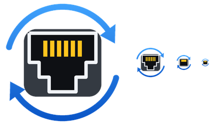
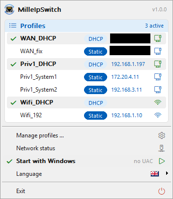
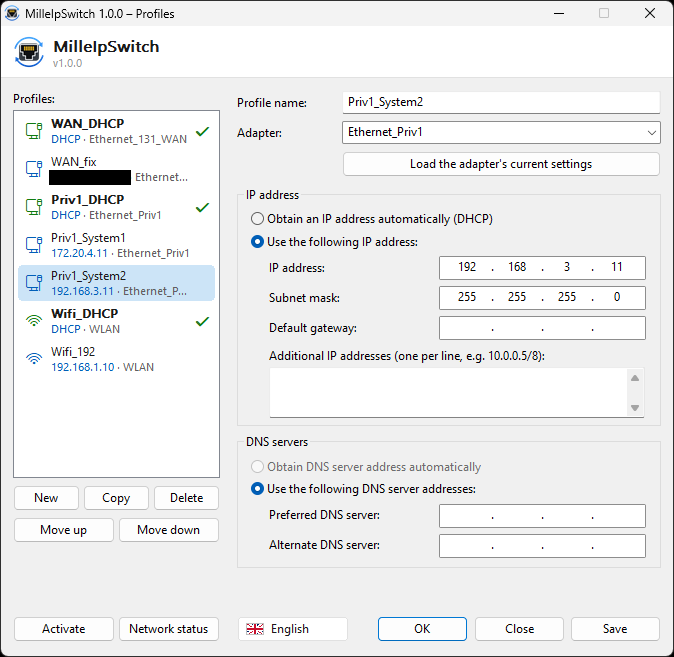
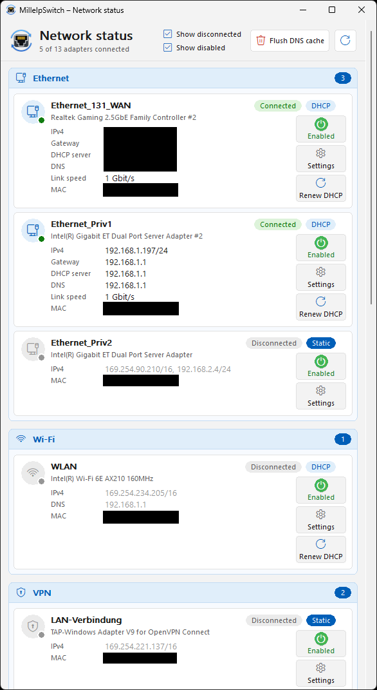

<p align="center">
  
</p>

<h1 align="center">MilleIpSwitch</h1>

<p align="center">
  Fast, lightweight network profile switcher for Windows – a small alternative to NetSetMan.<br>
  <b>English</b> · <a href="README.de.md">Deutsch</a>
</p>

<p align="center">
  <a href="../../actions/workflows/build.yml"></a>
  <a href="../../releases/latest"></a>
  
  <a href="LICENSE"></a>
</p>

| Tray menu | Profile manager | Network status |
|---|---|---|
|  |  |  |

## Features

- **Switch IPv4 profiles in milliseconds** – static IP (also multiple addresses per adapter), subnet mask, gateway, DNS or DHCP
- **Tray menu** with the active profile(s) marked, one profile per adapter can be active at the same time
- **Hover card** on the tray icon with all connected adapters, IPs, link speed and active profiles
- **Profile manager** in the style of the Windows IPv4 dialog, including “load the adapter's current settings”
- **Network status** for all adapters, grouped into Ethernet, Wi-Fi, VPN, virtual and other – incl. DHCP server and MAC, an on/off switch per adapter and a shortcut to its properties
- **Command line** for scripts, hotkeys and the Stream Deck: `milleipswitch.exe "Lab"`
- **Autostart without UAC prompt** (Task Scheduler) – afterwards command line calls need no elevation either
- English, German, Spanish and French
- A single portable `.exe` (~500 KB), no installer, no runtime, no service

## Why it is fast

Most tools call `netsh` or WMI for every single setting. MilleIpSwitch talks to the Windows IP Helper API directly:

| Task | API |
|---|---|
| IP addresses | `CreateUnicastIpAddressEntry` / `DeleteUnicastIpAddressEntry` (no duplicate address detection delay) |
| Default gateway | `CreateIpForwardEntry2` / `DeleteIpForwardEntry2` |
| DNS | `SetInterfaceDnsSettings` (no DNS validation, Windows 10 2004+) |

Only settings that differ from the current state are changed. The single exception is switching between DHCP and static, which uses one `netsh` call because Windows has no documented API for it. The time each switch took is shown in the notification.

## Download

Get `milleipswitch.exe` from the [latest release](../../releases/latest) and put it into any folder, e.g. `C:\Tools\MilleIpSwitch\`. Profiles are stored in `profiles.ini` next to the exe.

> The exe is not code-signed, so Windows SmartScreen may warn on first start (“More info” → “Run anyway”).
> Because MilleIpSwitch changes network settings and can register an elevated autostart task, some antivirus
> products may flag it heuristically. The full source is in this repository – you can also build it yourself, see below.

## Usage

| Command | Effect |
|---|---|
| `milleipswitch.exe` | Starts MilleIpSwitch: tray icon and profile manager |
| `milleipswitch.exe --tray` | Tray icon only (used for autostart) |
| `milleipswitch.exe "<profile>"` | Applies a profile |
| `milleipswitch.exe --list` | Lists profiles (`*` = active) |
| `milleipswitch.exe --status` | Shows all adapters |
| `milleipswitch.exe --edit` | Opens the profile manager |
| `milleipswitch.exe --version` | Shows the version |

Exit codes: `0` OK, `1` error, `2` unknown profile, `3` error in profiles.ini, `4` switch already in progress.

Changing IP settings requires administrator rights. If the tray instance is running (elevated), command line calls are handed over to it, so no UAC prompt appears. Enable **Start with Windows** in the tray menu to get this from sign-in on.

## profiles.ini

Profiles can be edited in the GUI or by hand:

```ini
[Lab]
adapter = Ethernet
dhcp    = no
ip      = 192.168.10.50/24, 10.0.0.5/8
gateway = 192.168.10.1
dns     = 192.168.10.1, 1.1.1.1

[Office]
adapter = Ethernet
dhcp    = yes
```

See [`profiles.example.ini`](profiles.example.ini) for all options.

## Building

Requirements: Windows SDK and a C++17 compiler (Visual Studio 2019+ or MinGW-w64), CMake 3.20+.

**Visual Studio / VS Code:** open the folder (CMake is detected automatically) and build the `milleipswitch` target, or run `build.bat` from the *x64 Native Tools Command Prompt*.

**MinGW-w64 / MSYS2:**

```sh
cmake -S . -B build -G Ninja -DCMAKE_BUILD_TYPE=Release
cmake --build build
```

Every push is built by GitHub Actions; pushing a tag like `v1.0.0` creates a release with the exe attached.

The icon is generated by `tools/make_icon.py` (requires Pillow).

## Limitations

- IPv4 only
- No proxy, printer, domain or script settings – by design
- Moving the exe after enabling autostart: toggle *Start with Windows* off and on again

## License

[MIT](LICENSE)
